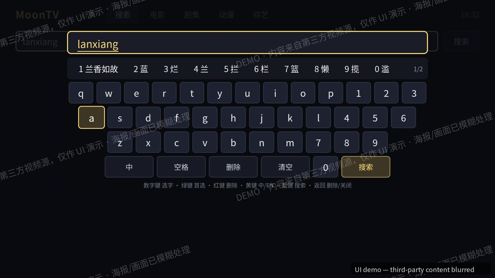
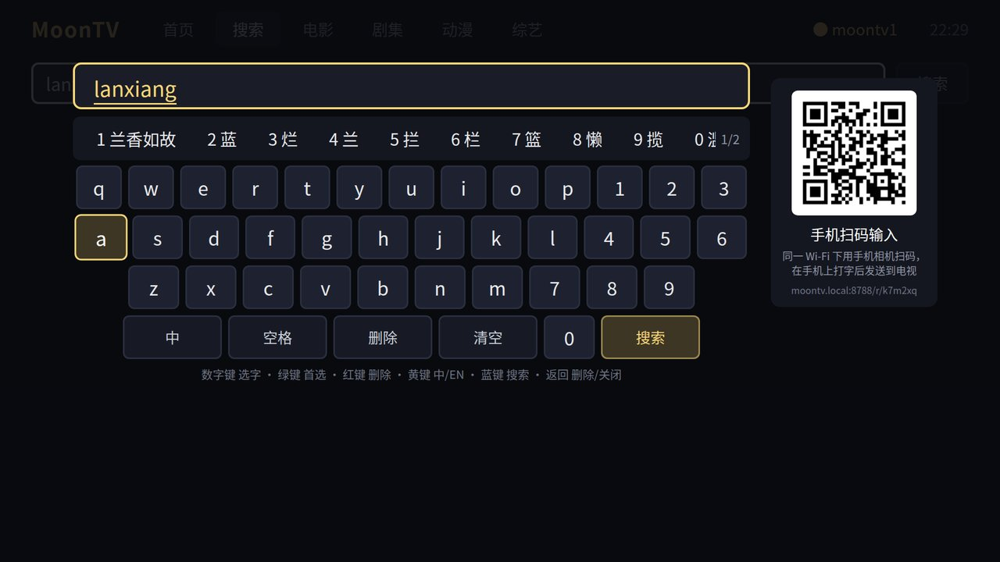
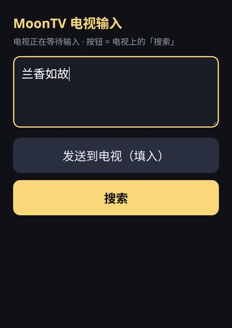

# MoonTV for LG webOS

[English](README.md) · [中文](README.zh-CN.md)

让老款 LG 电视也能用 [MoonTV / LunaTV](https://github.com/MoonTechLab/LunaTV) 看片，用遥控器就能操作。

## 这是什么

MoonTV 自带网页界面，在电脑和手机上都好用，但在老款 LG 电视上打不开：2018 年前后的 webOS 电视，内置浏览器内核还是 Chrome 53，跑不动 MoonTV 用的新版 JavaScript，打开只有一堆文字，没有海报也点不了。

这个项目重新做了一套电视专用界面，装到电视上就是一个独立的应用。它只负责显示和遥控，数据还是从你自己的 MoonTV 来，中间多了一个很小的转接服务（下文叫"桥接"），和 MoonTV 一起跑在 Docker 里。


| 按分类浏览，可以筛选 | 自带拼音键盘 |
|---|---|
|  |  |

## 能做什么

**遥控器操作**。方向键移动，OK 确认，返回键回上一级。字够大，坐在沙发上看得清。

**打中文不用遥控器戳字母**。欧版 LG 电视的输入法没有中文，所以应用自带一个拼音键盘，支持全拼、简拼（比如打 `lxrg` 出"兰香如故"），还会从你的 MoonTV 里拿最近的片名做联想。

**用手机打字更快**。键盘旁边有一个二维码。手机和电视连同一个 Wi-Fi，用相机扫一下，手机上会打开一个输入页，打完字按一下就发到电视上。不用装 App。

| 电视：键盘和二维码 | 手机：输入页 |
|---|---|
|  |  |

**家里几个人用，各看各的**。每个人用自己的 MoonTV 账号登录一次，电视就记住了。下次开机直接进上次那个人的账号；想换人，在顶栏点用户名退出，就会出现一个选人页面，点头像进入，不用再输密码。

**没有电视也能试**。在电脑浏览器打开 `http://<桥接地址>:8788/`，会看到一台"模拟电视"和一个画出来的遥控器，跑的就是电视上那套界面。改东西的时候用它看效果很方便。

## 需要准备什么

- 一台 LG webOS 电视。我在 webOS 4.4（2018 年的 OLED B8）上开发和测试，更新的型号应该也可以。
- 已经在跑的 MoonTV，用 Docker 部署。
- 电视要开"开发者模式"才能装自己的应用。LG 官方的 Developer Mode 应用从电视的应用商店装，免费，要注册一个 LG 开发者账号。开发者模式有时限（新固件 1000 小时），到期前在那个应用里点一下 Extend 续期就行。
- 一台电脑用来打包和安装，装 Node.js 就够。

## 安装步骤

### 第一步：把桥接加到 MoonTV 旁边

桥接是一个 Python 小程序，打包成 Docker 镜像，和 MoonTV 放在同一个 compose 里。打开你 MoonTV 的 `docker-compose.yml`，把 [api/compose.snippet.yml](api/compose.snippet.yml) 里的那段服务抄进去，改三个地方：

- `MOONTV_USER` 和 `MOONTV_PASS`：填一个 MoonTV 账号，桥接用它登录。
- 网络名要和 `moontv-core` 用的一致。
- 端口默认 8788，不想改就不用动。

镜像直接从本仓库的 GitHub 地址构建，你的服务器上不需要放源码。改完执行 `docker compose up -d --build`，或者在 Portainer 里更新这个栈。

验证一下：浏览器打开 `http://<服务器IP>:8788/`，能看到模拟电视就说明通了。

如果不想合进 MoonTV 的 compose，也可以单独跑：

```bash
docker build -t moontv-api -f api/Dockerfile https://github.com/coomteng/moontv-webos.git#main
docker run -d -p 8788:8788 \
  -e MOONTV_UPSTREAM=http://<MoonTV地址>:3000 \
  -e MOONTV_USER=<账号> -e MOONTV_PASS=<密码> \
  moontv-api
```

### 第二步：把应用装到电视上

在电脑上：

```bash
npm install -g @webos-tools/cli
git clone https://github.com/coomteng/moontv-webos.git
cd moontv-webos

# 告诉应用桥接在哪（这个文件不会提交到 git）
echo 'BRIDGE_BASE=http://<服务器IP>:8788' > local.env

# 注册电视：按提示填电视的 IP、端口 9922、用户名 prisoner，
# 然后在电视的 Developer Mode 应用里打开 Key Server，输入屏幕上的 6 位密码
ares-setup-device
ares-novacom --device <电视名> --getkey

# 打包并安装
tools/build_ipk.sh
ares-install --device <电视名> dist/*.ipk
```

装完电视主屏上会多一个 MoonTV 图标。第一次打开会让你登录 MoonTV 账号，以后就不用了。

更细的说明（遥控器按键、怎么更新、怎么预置账号）在 [app/README.md](app/README.md)。

## 常见问题

**为什么要多跑一个桥接，不能直接连 MoonTV 吗？**
电视应用是从本地文件启动的，浏览器不允许它带着 MoonTV 的登录 cookie 去请求数据，MoonTV 也不支持别的登录方式。桥接替电视登录，再把数据转给它。桥接只用 Python 标准库，没有别的依赖。

**安全吗？**
桥接没有做访问控制，设计上只在家里的局域网用。不要把 8788 端口开到公网。

**模拟器里能用，电视上就一定能用吗？**
不一定。电脑浏览器比电视新得多。仓库里有一个语法检查脚本，保证代码不会用到 Chrome 53 不认识的写法，但最终还是要在电视上试一遍。

## 仓库里有什么

| 目录 | 内容 |
|---|---|
| `app/` | 电视应用本身。纯 HTML、CSS、JavaScript，没有构建步骤。 |
| `api/` | 桥接程序 `moontv-api.py`，加上 Dockerfile 和 compose 片段。 |
| `sim/` | 浏览器里的模拟电视页面。 |
| `tools/` | 打包脚本 `build_ipk.sh`，拼音词表生成脚本 `gen_pinyin.py`。 |
| `test/` | 无需电视的自动化走查脚本。 |

## 许可

MIT
